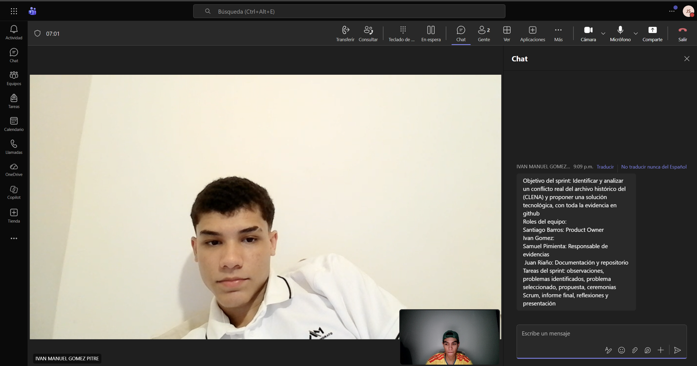
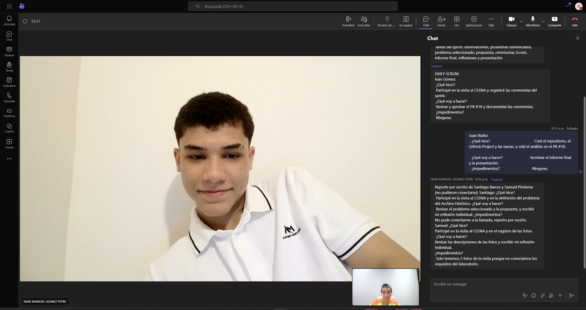
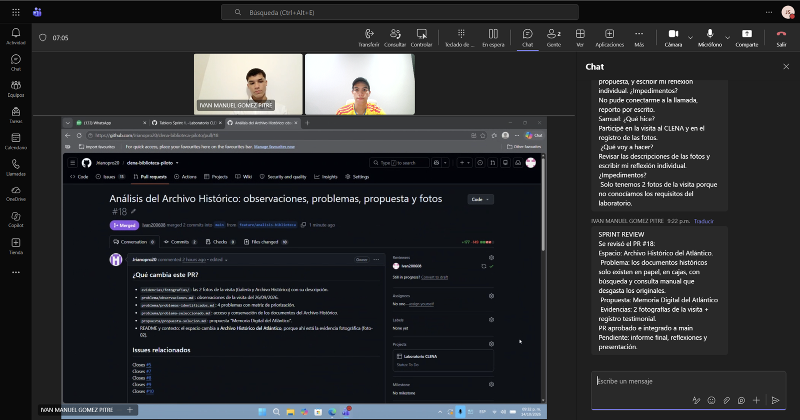
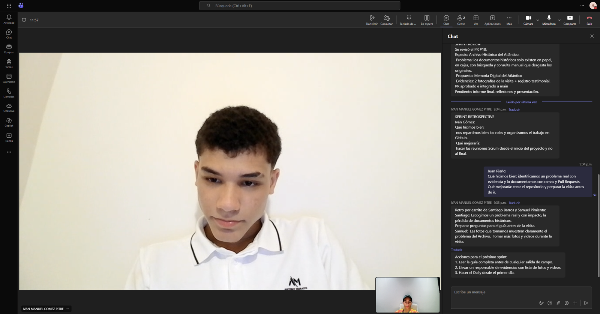

# Evidencias Scrum y GitHub

Capturas de la sesión en Microsoft Teams del 14/10/2026. Participaron en la llamada Iván Gómez y Juan Riaño; Santiago Barros y Samuel Pimienta reportaron por escrito.

| Archivo | Qué muestra |
|---|---|
|  `01-sprint-planning.png` | **Sprint Planning:** objetivo del sprint, roles y tareas publicados en el chat de Teams. |
|  `02-daily-scrum.png` | **Daily Scrum:** respuestas de Iván y Juan, y reporte escrito de Santiago y Samuel. |
|  `03-sprint-review.png` | **Sprint Review:** pantalla compartida con el PR #18 aprobado e integrado (*Merged*) por Iván, y el resumen en el chat. |
|  `04-sprint-retrospective.png` | **Sprint Retrospective:** qué hicimos bien, qué mejorar y acciones para el próximo sprint. |
