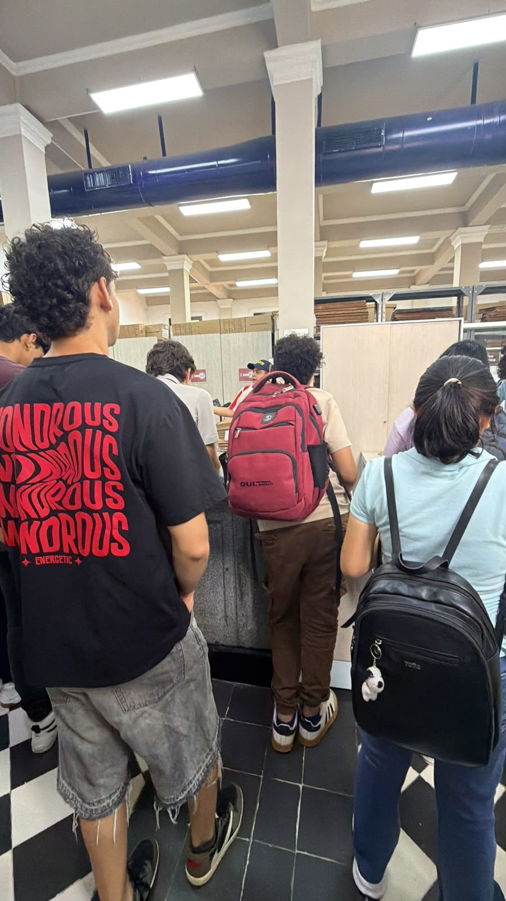
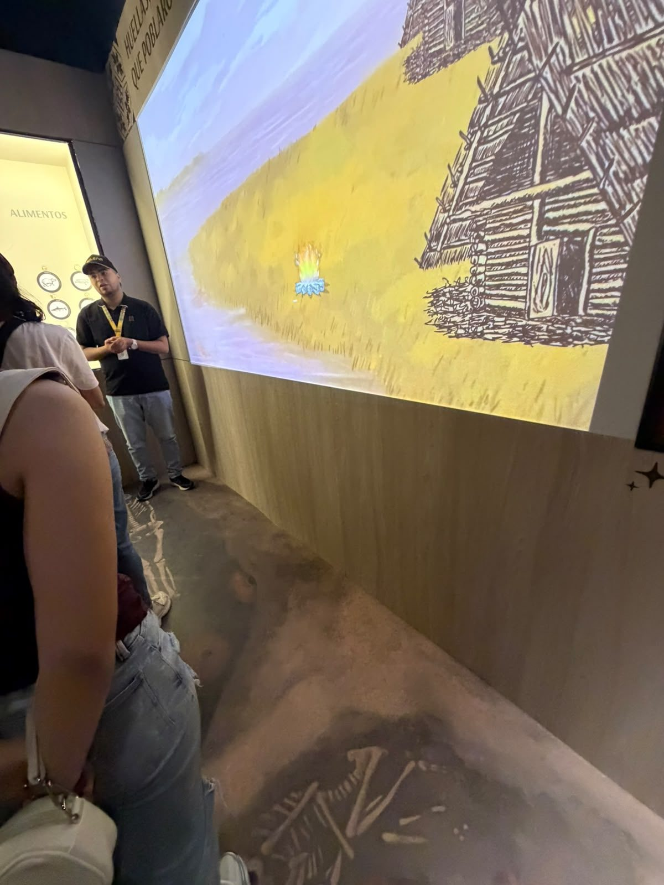

# Evidencias fotográficas

Fotografías tomadas por el equipo durante la visita al CLENA el 26/09/2026.

> **Aclaración:** el equipo tomó pocas fotografías porque, en el momento de la visita, aún no conocía los requisitos de este laboratorio. Las observaciones se complementan con el registro testimonial de los cuatro integrantes (`problema/observaciones.md`). Cualquier imagen que no sea propia se marca como **imagen de referencia**, con su fuente.

| Archivo | Descripción | Lugar | Relación con el problema |
|---|---|---|---|
|  `foto-02-archivo-historico-deposito-cajas.jpg` | Grupo de estudiantes en la zona de atención del Archivo Histórico. Al fondo se ven **estanterías metálicas con cajas de cartón** y archivadores donde se guardan los documentos históricos. | Archivo Histórico del Atlántico | **Evidencia principal.** Muestra que los documentos se conservan en cajas físicas y que su consulta pasa por la atención del personal, en un proceso manual. |
|  `foto-01-galeria-memoria-urbana-recorrido-guiado.jpg` | El guía explica la historia de los primeros pobladores de la región frente a una **proyección animada**. A la izquierda, una vitrina temática ("Alimentos"). | Centro Interactivo de Memoria Urbana – Galería de la Aduana | **Contraste.** La Galería ya usa tecnología (proyecciones, ambientación interactiva) para contar la historia, mientras que en el Archivo, donde están los documentos originales, todo sigue siendo físico y manual. |

**Privacidad:** en las fotos no aparecen documentos restringidos. Los estudiantes aparecen de espaldas. El guía aparece en ejercicio de su labor durante un recorrido académico. Las imágenes se usan solo como evidencia académica.
