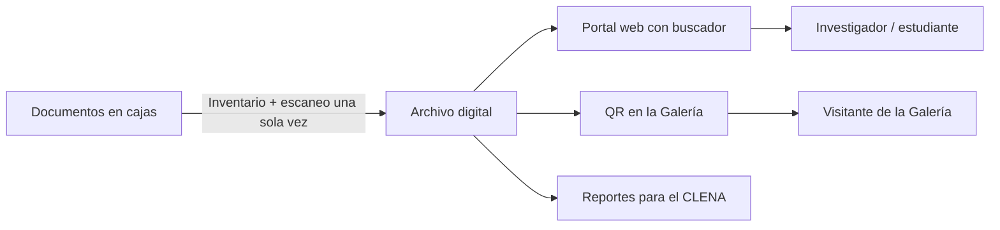

# Informe final — Laboratorio de campo CLENA

**Proyecto:** Memoria Digital del Atlántico
**Curso:** Introducción a la Ingeniería de Sistemas y Computación — Universidad del Norte
**Docente:** Daniel Romero
**Equipo:** Santiago Barros, Iván Gómez, Samuel Pimienta, Juan Riaño
**Fecha de la visita:** 26/09/2026  ·  **Fecha del informe:** 14/10/2026
**Repositorio:** https://github.com/Jrianopro20/clena-biblioteca-piloto

---

## 1. Información del equipo

| Integrante | Rol | Espacio estudiado |
|---|---|---|
| Santiago Barros | Product Owner | Archivo Histórico del Atlántico |
| Iván Gómez | Scrum Master | Archivo Histórico del Atlántico |
| Samuel Pimienta | Responsable de evidencias | Archivo Histórico del Atlántico |
| Juan Riaño | Documentación y repositorio | Archivo Histórico del Atlántico |

## 2. Contexto

El **CLENA** (Corporación Luis Eduardo Nieto Arteta) administra el proyecto cultural del antiguo edificio de la Aduana de Barranquilla. El edificio fue construido en 1919, declarado Monumento Nacional en 1984 y restaurado en 1994. Hoy alberga la Biblioteca Piloto del Caribe, el Archivo Histórico del Atlántico, la Biblioteca Infantil y el Centro Interactivo de Memoria Urbana.

El **Archivo Histórico del Atlántico** conserva el patrimonio documental del departamento: registros, censos, planes de desarrollo y propuestas urbanísticas. En la visita se vio la zona de atención y, detrás, el depósito con estanterías metálicas y cajas de cartón donde se guardan los documentos. Ver `docs/contexto-clena.md`.

## 3. Observaciones

El equipo hizo un recorrido guiado por todo el CLENA. Las observaciones principales fueron:

1. El Archivo funciona de forma **física y manual**: los documentos se guardan en cajas de cartón sobre estanterías (`foto-02`).
2. El usuario **depende del personal** para saber qué hay y para obtener un documento.
3. Los documentos son **originales antiguos y frágiles**, y cada consulta implica manipularlos.
4. En la Galería la historia se cuenta **con tecnología** (proyecciones e interactividad, `foto-01`), pero en el Archivo, donde están las fuentes reales, no se observó ninguna herramienta digital para el visitante.
5. El conocimiento sobre qué hay en el archivo está en las personas que trabajan allí.

Detalle completo en `problema/observaciones.md`.

## 4. Problemas identificados

| # | Problema | Puntaje |
|---|---|---|
| P1 | Los documentos históricos solo existen en papel y se deterioran con su uso | 21 |
| P2 | Encontrar un documento depende del personal | 20 |
| P3 | Los registros y procesos son manuales | 16 |
| P4 | La tecnología del CLENA está en la exhibición, no en el patrimonio original | 17 |

Detalle y matriz de priorización en `problema/problemas-identificados.md`.

## 5. Problema seleccionado

> Los investigadores, estudiantes y ciudadanos que acuden al Archivo Histórico del Atlántico no pueden saber por su cuenta qué documentos existen ni consultar su contenido sin manipular los originales, porque estos se conservan únicamente en papel, en cajas de cartón, y su búsqueda y entrega dependen de un proceso manual a cargo del personal. Esto hace la consulta lenta, limita el acceso a la memoria documental de Barranquilla y el Atlántico, y expone documentos únicos a un desgaste que puede terminar en su pérdida irreversible.

**Justificación:** P1 y P2 obtuvieron los puntajes más altos y comparten la misma causa: el patrimonio documental solo existe en papel y se gestiona a mano. Es el único problema con consecuencias irreversibles y está respaldado con evidencia fotográfica propia.

## 6. Usuarios afectados

| Actor | Tipo |
|---|---|
| Investigadores e historiadores | Usuario directo |
| Estudiantes (colegios y universidades) | Usuario directo |
| Personal del Archivo | Responsable del proceso |
| CLENA | Administrador |
| Visitantes de la Galería | Visitante |
| Ciudadanía del Atlántico | Usuario indirecto |

## 7. Evidencias

| Foto | Descripción |
|---|---|
|  | **Archivo Histórico del Atlántico.** Zona de atención; al fondo, estanterías metálicas con cajas de cartón donde se guardan los documentos. Es la evidencia principal del problema. |
|  | **Centro Interactivo de Memoria Urbana.** El guía explica la historia frente a una proyección animada. Muestra el contraste: la exhibición ya es tecnológica, el archivo no. |

**Limitación:** el equipo tomó solo dos fotografías porque aún no conocía los requisitos del laboratorio cuando hizo la visita. Las demás observaciones son registro testimonial de los integrantes.

## 8. Propuesta de solución: Memoria Digital del Atlántico

| Pregunta | Respuesta |
|---|---|
| **¿Qué se propone?** | Un archivo digital con cuatro partes: inventario digital de las cajas, digitalización de los documentos, portal web con buscador y códigos QR en la Galería. |
| **¿Para quién?** | Investigadores, estudiantes, personal del Archivo, el CLENA y visitantes de la Galería. |
| **¿Qué problema resuelve?** | Permite saber qué existe sin depender del personal y consultar el contenido sin manipular los originales. |
| **¿Cómo funcionaría?** | El personal inventaría y escanea cada documento una sola vez. El usuario busca en el portal o escanea un QR en la Galería, lee el documento con zoom y, si necesita el original, lo solicita sabiendo en qué caja y estante está. |
| **¿Qué tecnología?** | Escáner cenital, sistema de gestión de archivos de código abierto (AtoM u Omeka), base de datos de metadatos, visor IIIF, códigos QR y, en una segunda fase, OCR. |

**Implementación por fases:** (1) inventario digital, (2) digitalización de los documentos más consultados o frágiles, (3) QR en la Galería. Detalle en `propuesta/propuesta-solucion.md`.

## 9. Scrum

| Ceremonia | Fecha | Evidencia |
|---|---|---|
| Sprint Planning | 14/10/2026 | `docs/sprint-planning.md` · `evidencias/evidencias-scrum/01-sprint-planning.png` |
| Daily Scrum | 14/10/2026 | `docs/daily-scrum.md` · `02-daily-scrum.png` |
| Sprint Review | 14/10/2026 | `docs/sprint-review.md` · `03-sprint-review.png` |
| Sprint Retrospective | 14/10/2026 | `docs/sprint-retrospective.md` · `04-sprint-retrospective.png` |

Las ceremonias se hicieron por Microsoft Teams. Juan Riaño e Iván Gómez participaron en la llamada, y Santiago Barros y Samuel Pimienta reportaron por escrito.

## 10. GitHub

- **Repositorio:** https://github.com/Jrianopro20/clena-biblioteca-piloto
- **GitHub Project:** tablero "Laboratorio CLENA" con las columnas Backlog, To Do, In Progress, Review y Done.
- **Issues:** 17 tareas, con responsable, prioridad, labels y entregable.
- **Ramas:** `feature/analisis-biblioteca`, `feature/observaciones`, `feature/problemas-identificados`, `feature/formulacion-problema`, `feature/propuesta-solucion`, `docs/evidencias`, `docs/scrum`, `docs/informe-final` y `docs/presentacion`.
- **Pull Requests:** #18 (análisis completo, revisado por Iván Gómez e integrado a `main`) y los PR de documentación Scrum e informe.

## 11. Reflexiones individuales

Ver `informe/reflexiones/`.

## 12. Conclusiones del equipo

1. **Observar antes de proponer cambia la solución.** Si hubiéramos empezado pensando en una app, habríamos propuesto una guía turística. Al observar, encontramos que el problema real está en el Archivo: documentos únicos que solo existen en papel.
2. **La tecnología ya existe en el CLENA, pero mal distribuida.** La Galería es interactiva, mientras que el Archivo, donde están las fuentes, sigue en cajas.
3. **La documentación es parte del trabajo de ingeniería.** No tomar fotos nos dejó con poca evidencia y fue nuestro principal aprendizaje del sprint.
4. **Scrum y GitHub ordenan el trabajo en equipo.** Las ramas, los Pull Requests y la revisión de otro integrante hicieron visible quién hizo qué.
