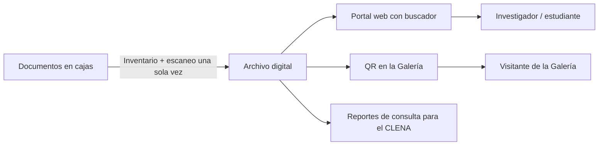

# Propuesta de solución tecnológica

## ¿Qué se propone?

**"Memoria Digital del Atlántico"**: un **archivo digital** de los documentos históricos del Archivo Histórico del Atlántico. Tiene cuatro partes:

1. **Inventario digital** de lo que hay en cada caja, que se puede buscar en línea.
2. **Digitalización** de los documentos, escaneando cada uno una sola vez y empezando por los más consultados o más frágiles.
3. **Portal web** donde cualquier persona busca y lee los documentos digitalizados desde su celular o computador.
4. **Códigos QR en la Galería** que conectan cada tema de la exhibición con los documentos originales que lo respaldan.

## ¿Para quién?

| Usuario | Cómo la usa |
|---|---|
| Investigadores y estudiantes | Buscan qué documentos existen y los leen desde cualquier lugar, sin pedir el original. |
| Visitantes de la Galería | Escanean el QR de una vitrina y ven el documento histórico real que respalda lo que están viendo. |
| Personal del Archivo | Ubica documentos al instante en el inventario y solo saca el original cuando es estrictamente necesario. |
| CLENA | Consulta qué documentos son los más vistos para decidir qué digitalizar, restaurar o exhibir. |

## ¿Qué problema resuelve?

| Causa del problema | Cómo la ataca la solución |
|---|---|
| Los documentos solo existen en formato físico | Se crea una copia digital permanente de cada documento. |
| No hay inventario consultable por el usuario | El inventario digital es público y tiene buscador. |
| La búsqueda y el registro son manuales | El sistema ubica el documento (caja y estante) y registra cada consulta automáticamente. |
| Cada consulta desgasta el original | El original se manipula una sola vez, para escanearlo, y luego queda protegido. |

## ¿Cómo funcionaría?

**Para el usuario:**
1. Entra al portal web o escanea un QR en la Galería.
2. Busca por tema, año, tipo de documento o palabra clave.
3. Abre el documento y lo lee con zoom.
4. Si necesita el original para una investigación, lo solicita desde el portal, que ya indica en qué caja y estante está.

**Para el personal:**
1. Registra en el inventario el contenido de cada caja: tipo de documento, fecha, tema y ubicación.
2. Escanea los documentos priorizados una sola vez.
3. Los sube al sistema con sus datos y su estado de conservación.
4. El sistema genera los QR que se ponen en la Galería.

## ¿Qué tecnología podría utilizarse?

| Componente | Tecnología | ¿Por qué esta? |
|---|---|---|
| Digitalización | Escáner cenital (escanea desde arriba, sin contacto agresivo) | Es el método recomendado para documentos frágiles. |
| Inventario y portal | Sistema de gestión de archivos (por ejemplo AtoM o Omeka, ambos de código abierto y usados por archivos históricos) | Son gratuitos, están hechos para archivos patrimoniales y no requieren desarrollar desde cero. |
| Base de datos | Base de datos de metadatos (tipo, fecha, tema, caja, estante, estado) | Permite búsquedas rápidas, ubicación física y reportes. |
| Conexión con la Galería | Códigos QR | Son baratos, cualquier celular los lee y no exigen instalar una app. |
| Visor | Visor de imágenes con zoom (IIIF) | Es el estándar internacional para mostrar documentos patrimoniales. |
| Búsqueda dentro del texto (fase 2) | OCR / inteligencia artificial | Convierte las páginas escaneadas en texto buscable. |

## Alternativas consideradas

| Alternativa | Ventaja | Desventaja | ¿Por qué no la elegimos? |
|---|---|---|---|
| Aplicación móvil propia | Mejor experiencia | Costosa de desarrollar y mantener, y hay que instalarla | Una web con QR logra lo mismo sin instalación. |
| Solo el inventario digital, sin digitalizar | Barato y rápido | No protege los originales | Resuelve la búsqueda pero no la conservación. Lo usamos como **fase 1**. |
| Restringir aún más el acceso | Protege los documentos | Nadie puede consultarlos | Empeora el problema de acceso. |

## Viabilidad

- **Costo aproximado:** el software puede ser de código abierto (sin licencia). El costo principal es el escáner, que también puede conseguirse en préstamo o en alianza con universidades como Uninorte, y las horas de digitalización.
- **Qué necesita el CLENA:** un escáner, una persona capacitada para inventariar y digitalizar, alojamiento web y conexión a internet en la Galería para los QR.
- **Implementación por fases:** (1) inventario digital de las cajas; (2) digitalización de los documentos más consultados o más frágiles; (3) QR en la Galería.
- **Riesgos:** documentos con información personal (por ejemplo registros civiles), que deben publicarse con restricciones; daño del documento durante el escaneo (se mitiga con escáner cenital y personal capacitado); y el costo de mantener el servidor.

## ¿Cómo sabríamos que funciona?

| Indicador | Situación actual | Meta con la solución |
|---|---|---|
| Cajas con inventario digital | No observamos un inventario consultable por el usuario | 100% de las cajas |
| Documentos con versión digital | No observamos acceso digital para el usuario | 100% de los documentos priorizados |
| Manipulaciones del original | Una por cada consulta | Solo para investigación especializada |
| Personas que acceden al contenido | Solo quienes van al archivo y lo solicitan | Cualquier persona con internet |
| Consultas registradas | Registro manual | Registro automático con reportes |
