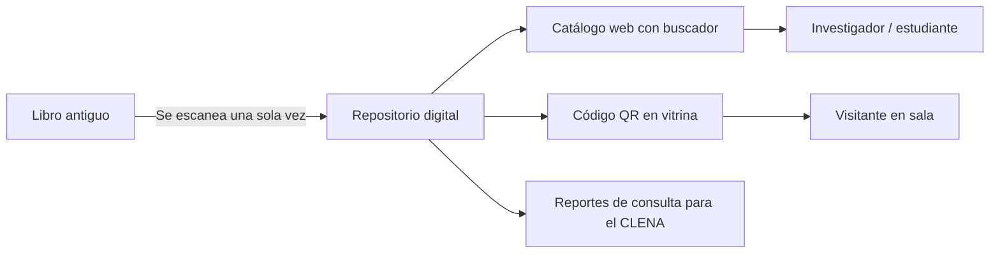

# Propuesta de solución tecnológica

## ¿Qué se propone?

**"Memoria Digital del Caribe"**: un **repositorio digital de la colección de libros antiguos** de la Biblioteca Piloto del Caribe. Tiene tres partes:

1. **Digitalización** de los libros antiguos, escaneando cada página una sola vez.
2. **Catálogo web** donde cualquier persona busca y lee los libros digitalizados desde su celular o computador.
3. **Códigos QR** en las vitrinas de la biblioteca que llevan directamente a la versión digital de cada libro.

## ¿Para quién?

| Usuario | Cómo la usa |
|---|---|
| Investigadores y estudiantes | Buscan y leen los libros desde cualquier lugar, sin solicitar el ejemplar físico. |
| Visitantes | Escanean el QR de la vitrina y hojean el libro en su celular. |
| Personal de la biblioteca | Atiende las consultas mostrando la versión digital y solo saca el original cuando es estrictamente necesario. |
| CLENA | Consulta qué libros son los más vistos para decidir qué restaurar y qué difundir. |

## ¿Qué problema resuelve?

| Causa del problema | Cómo la ataca la solución |
|---|---|
| El contenido solo existe en el ejemplar físico | Se crea una copia digital permanente de cada página. |
| La consulta es manual y depende del personal | El usuario busca y lee por su cuenta. |
| No hay forma de conocer la colección de manera autónoma | Hay un catálogo público con búsqueda y QR en la sala. |
| Cada consulta desgasta el libro | El original se manipula una sola vez, para escanearlo, y luego queda protegido. |

## ¿Cómo funcionaría?

**Para el usuario:**
1. Entra al catálogo web o escanea el QR de una vitrina.
2. Busca por título, autor, año o tema.
3. Abre el libro y lo hojea página por página, con zoom.
4. Si necesita el original para una investigación, lo solicita desde la misma página.

**Para el personal:**
1. Escanea el libro una sola vez.
2. Lo sube al sistema con sus datos (título, autor, año, tema, estado de conservación).
3. El sistema genera el QR, que se imprime y se pone en la vitrina.

## ¿Qué tecnología podría utilizarse?

| Componente | Tecnología | ¿Por qué esta? |
|---|---|---|
| Digitalización | Escáner cenital (escanea desde arriba, sin aplastar el lomo) | Es el método recomendado para libros frágiles. |
| Repositorio y catálogo | Aplicación web (por ejemplo Omeka o DSpace, ambos de código abierto y usados por bibliotecas) | Son gratuitos, están hechos para colecciones patrimoniales y no requieren desarrollar desde cero. |
| Base de datos | Base de datos de metadatos (título, autor, año, tema, estado) | Permite búsquedas rápidas y reportes. |
| Acceso en sala | Códigos QR | Son baratos, cualquier celular los lee y no exigen instalar una app. |
| Visor | Visor de imágenes con zoom (IIIF) | Es el estándar internacional para mostrar documentos patrimoniales. |
| Búsqueda dentro del texto (fase 2) | OCR / inteligencia artificial | Convierte las páginas escaneadas en texto buscable. |

## Alternativas consideradas

| Alternativa | Ventaja | Desventaja | ¿Por qué no la elegimos? |
|---|---|---|---|
| Aplicación móvil propia | Mejor experiencia | Costosa de desarrollar y mantener, y hay que instalarla | Una web con QR logra lo mismo sin instalación. |
| Solo un catálogo digital, sin digitalizar | Barato | No protege los libros ni da acceso al contenido | No resuelve la causa principal. |
| Restringir aún más el acceso | Protege los libros | Nadie puede consultarlos | Empeora el problema de acceso. |

## Viabilidad

- **Costo aproximado:** el software puede ser de código abierto (sin licencia). El costo principal es el escáner, que también puede conseguirse en préstamo o en alianza con universidades como Uninorte, y las horas de digitalización.
- **Qué necesita el CLENA:** un escáner, una persona capacitada para digitalizar, alojamiento web y conexión a internet en la sala para los QR.
- **Implementación por fases:** empezar con los 10 a 20 libros más pedidos o más frágiles y ampliar después.
- **Riesgos:** derechos de autor (los libros antiguos suelen ser de dominio público, pero hay que verificarlo), daño del libro durante el escaneo (se mitiga con escáner cenital y personal capacitado) y costo de mantener el servidor.

## ¿Cómo sabríamos que funciona?

| Indicador | Situación actual | Meta con la solución |
|---|---|---|
| Libros antiguos con versión digital | Ninguno consultable libremente (según lo observado) | 100% de la colección priorizada |
| Manipulaciones del ejemplar original | Una por cada consulta | Solo para investigación especializada |
| Personas que acceden al contenido | Solo quienes van a la biblioteca y lo solicitan | Cualquier persona con internet |
| Consultas registradas | Registro manual | Registro automático con reportes |
